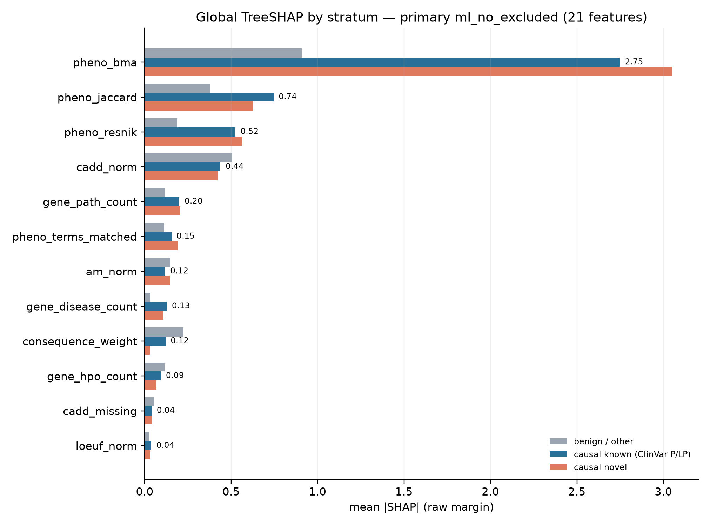
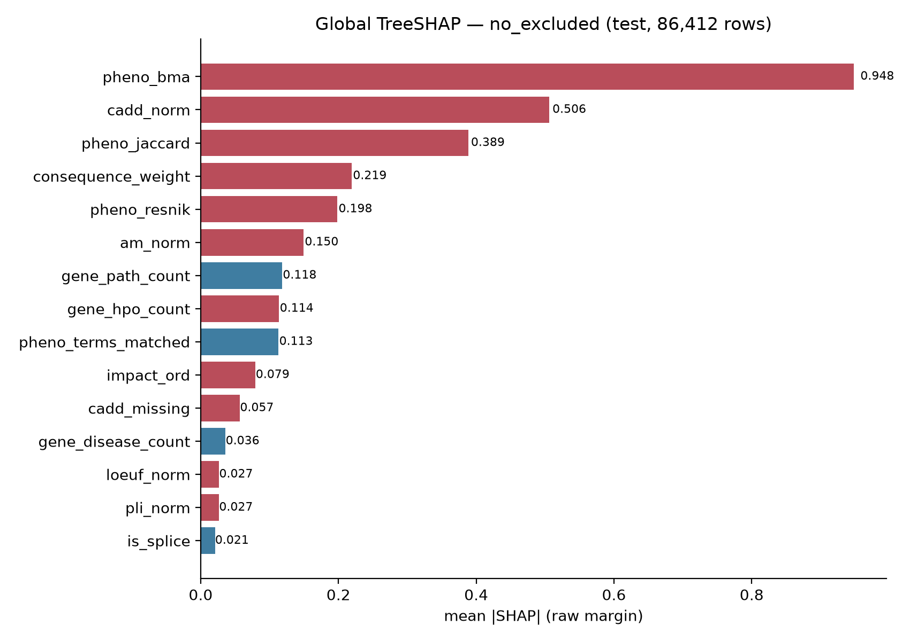
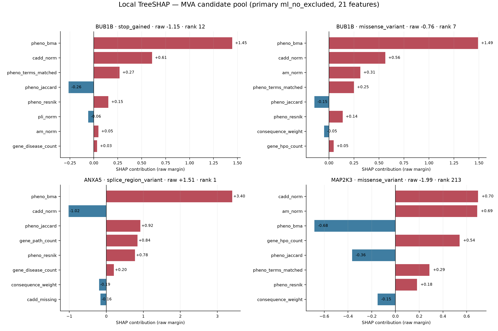

# Análisis SHAP — ranker LightGBM de priorización de variantes

**Fecha:** 2026-10-31 (actualizado 2026-11-04) · **Modelo previo:** `models/ml_no_excluded/ranker.txt` (LightGBM 21 features) · **Overlay:** `models/ranker.txt` (23 features) · **Primary actual:** CatBoost, ver `reports/catboost_report.md`

**Test:** 86.412 filas, 1.765 queries, 1.857 filas causales (`label=3`). Candidatos generados con el mismo pipeline que serving; genes held-out.

**Método:** `LightGBM Booster.predict(X, pred_contrib=True)`, que implementa el mismo TreeSHAP que `shap.TreeExplainer` sin añadir la dependencia. Las contribuciones están en **raw margin**, no en probabilidad calibrada:

```
raw_score = bias + Σ shap_feature
```

- bias primary = **-3,3396**; bias overlay = **-3,9016**.
- Una contribución positiva empuja el score hacia arriba; una negativa lo empuja hacia abajo.
- La calibración isotónica es monótona pero no lineal: un SHAP de +1,5 no equivale a un aumento fijo de probabilidad.
- TreeSHAP reparte crédito entre features correlacionadas (p. ej. `pheno_bma`, `pheno_resnik`, `pheno_jaccard`). No debe leerse como un efecto causal independiente.

**Resumen en tres frases:** (1) el modelo desplegable es sobre todo un *matcher* fenotípico (`pheno_bma` mean |SHAP| 0,948; 2,822 en causales) con CADD como tie-breaker, no un clasificador de consecuencia; (2) en MVA, BUB1B se sostiene por fenotipo+CADD, ANXA5 es un artefacto de `HP:0200067` y los no codificantes del top son artefactos de la rama de consecuencia/ClinVar; (3) el primary previo incluía `pheno_excluded_overlap`, una feature train-only: el reentrenamiento sin ella y sin `clinvar_score` deja **0,9357 / 0,8669** y es el modelo desplegado.

---

## 1. SHAP global — qué mira el modelo

| # | Feature | mean \|SHAP\| global | causal | benigno | causal conocido | causal novel |
|---:|---|---:|---:|---:|---:|---:|
| 1 | `pheno_bma` | **0,948** | **2,822** | 0,907 | 2,748 | 3,050 |
| 2 | `cadd_norm` | 0,506 | 0,434 | 0,507 | 0,438 | 0,422 |
| 3 | `pheno_jaccard` | 0,389 | 0,716 | 0,381 | 0,745 | 0,627 |
| 4 | `consequence_weight` | 0,219 | 0,098 | 0,221 | 0,120 | 0,029 |
| 5 | `pheno_resnik` | 0,198 | 0,533 | 0,191 | 0,524 | 0,563 |
| 6 | `am_norm` | 0,150 | 0,125 | 0,150 | 0,118 | 0,146 |
| 7 | `gene_path_count` | 0,118 | 0,202 | 0,116 | 0,200 | 0,205 |
| 8 | `gene_hpo_count` | 0,114 | 0,087 | 0,114 | 0,093 | 0,069 |
| 9 | `pheno_terms_matched` | 0,113 | 0,163 | 0,112 | 0,154 | 0,192 |
| 10 | `impact_ord` | 0,079 | 0,028 | 0,080 | 0,034 | 0,010 |
| 11 | `cadd_missing` | 0,057 | 0,041 | 0,057 | 0,040 | 0,044 |
| 12 | `gene_disease_count` | 0,036 | **0,123** | 0,034 | 0,127 | 0,108 |





Lectura:

1. **El modelo es, sobre todo, un matcher fenotípico.** `pheno_bma` concentra la mayor contribución: 2,82 de media en filas causales, suficiente para superar el bias de -3,34. Le siguen `pheno_jaccard` (0,72) y `pheno_resnik` (0,53) en filas causales. Las features fenotípicas (`bma`, `jaccard`, `resnik`) ocupan 3 de los 4 primeros puestos por magnitud causal.
2. **CADD es el segundo eje, pero no separa causal de benigno.** Su magnitud es casi idéntica en causal (0,434) y benigno (0,507); funciona como prior de patogenicidad dentro de la query, no como evidencia diagnóstica. Su SHAP medio con signo es -0,124 porque la mayoría de filas tienen CADD bajo.
3. **La consecuencia pesa poco.** `consequence_weight` tiene 0,219 global pero solo 0,098 en causales; `is_lof` (0,003) e `is_missense` (0,005) son casi irrelevantes. El modelo no premia de forma explícita un `stop_gained`: eso explica en parte el rank 12 de BUB1B p.Leu737Ter.
4. **`gene_path_count` (0,118) es un prior de gen-enfermedad.** Ayuda a genes con muchas variantes ClinVar P/LP, pero es genérico (no hay lista MVA en las features).
5. **Features muertas:** `rare_score` (constante 1,0 porque gnomAD AF está diferido; 0 splits), `canonical` y `mane` (constantes en el VEP local; 0 splits). No aportan nada y deberían eliminarse del esquema o arreglarse.

### Conocido vs novel

La comparación es la prueba de que el primary no se apoya en la anotación ClinVar **a nivel de variante** (`clinvar_score` no está en el modelo). `gene_path_count` sí es un prior genético derivado de ClinVar, pero su magnitud es similar en conocido (0,200) y novel (0,205): no explica la diferencia de rendimiento.

| Feature | causal conocido | causal novel |
|---|---:|---:|
| `pheno_bma` | 2,748 | 3,050 |
| `pheno_jaccard` | 0,745 | 0,627 |
| `pheno_resnik` | 0,524 | 0,563 |
| `cadd_norm` | 0,438 | 0,422 |
| `consequence_weight` | 0,120 | 0,029 |

Las magnitudes son casi iguales en las features que mandan. La diferencia en `consequence_weight` sugiere que las causales conocidas incluyen más LoF publicados, no un atajo de ClinVar. Es coherente con el Recall@10 estratificado: 0,9954 en conocidas (1.318 queries) vs 0,9978 en novel (447).

---

## 2. El hallazgo incómodo: `pheno_excluded_overlap`

`pheno_excluded_overlap` = fracción de términos HPO del gen que están en el conjunto **excluido** de la query (fenotipos que el paciente *no* presenta).

| Métrica | Causal (n=1.857) | Benigno (n=84.555) |
|---|---:|---:|
| Valor medio de la feature | 0,090 | 0,012 |
| Filas con feature > 0 | **88,4%** | 37,3% |
| SHAP medio (signo) | **+0,819** | +0,002 |
| mean \|SHAP\| | **0,842** | 0,044 |

Es la anomalía principal del análisis. No es leakage de la etiqueta en sentido estricto —la feature se calcula solo con el fenopacket, no con el label—, pero sí es un **artefacto de curación/evaluación**:

- En 1.676 queries test con términos excluidos, el gen causal comparte al menos un término excluido en **1.567 (93,5%)**.
- En Phenopacket Store los términos excluidos suelen ser manifestaciones del mismo espectro diagnóstico que el paciente no presenta (p. ej. en `AHR`, términos de retina/visión excluidos; el gen causal está anotado a ellos). Funcionan como una huella del diagnóstico.
- **En serving la feature es siempre 0**: `prioritize.py` llama a `gene_similarity(qterms, gene, norm)` sin `excluded_terms`, y el YAML de HPO solo lleva términos positivos. El modelo la usa con 629 splits (4º por gain), pero en el VCF del paciente no existe.

Esto significa que el 0,938 de NDCG@10 del test **no es directamente desplegable**. Cuantificación:

| Escenario | NDCG@10 | Recall@1 | Recall@10 | Rank Points |
|---|---:|---:|---:|---:|
| Primary previo (con la feature) | 0,9381 | 0,8714 | 0,9972 | 97,1 |
| Mismo modelo, feature puesta a 0 en test | 0,9163 | 0,8238 | 0,9960 | 96,1 |
| **Reentrenado sin la feature, sin ClinVar (21 features, pool original)** | **0,9357** | **0,8669** | **0,9960** | **96,97** |
| Reentrenado sin la feature, con ClinVar (22 features, no desplegado) | 0,9332 | 0,8601 | 0,9960 | 96,88 |

El reentrenamiento correcto recupera casi todo: la señal fenotípica real está en `pheno_bma`/`resnik`/`jaccard`, no en los excluidos. La caída a 0,916 del modelo previo es una cota inferior porque el árbol no puede redistribuir el peso. La variante que conserva `clinvar_score` (22 features) es algo peor en test y reintroduce el prior ClinVar en el primary; se guarda como `models/ml_no_excluded_clinvar/`, no se despliega.

**Estado:** el primary ya se reentrenó sin las dos features y se pasó sobre las 5.079.064 variantes. La estimación desplegable es **0,9357**, no 0,938 ni 0,933. El artefacto parental de ANXA5 con 8 HPO persiste (§2.1).

Artefacto reproducible: `reports/shap_no_excluded_ablation.json`. Comando:

```bash
.venv/bin/python -m src.ml.train_ranker \
  --train data/ml/dataset_train.csv.gz --val data/ml/dataset_val.csv.gz \
  --outdir models/ml_no_excluded \
  --drop-features clinvar_score,pheno_excluded_overlap
```

### 2.1 Qué cambia en el caso MVA al reentrenar

El primary desplegable (21 features) se pasó sobre las 5.079.064 variantes, con 8 y con 7 HPO:

| Variante | Previo full-list 8 HPO | Previo full-list 7 HPO | Primary 21 full-list 8 HPO | Primary 21 full-list 7 HPO |
|---|---:|---:|---:|---:|
| BUB1B stop_gained (15:40209701 T>G) | 20 | 4 | **12** | **5** |
| BUB1B missense (15:40220612 T>G) | 12 | 14 | **7** | **2** |
| ANXA5 (4:121669728 T>TA) | 1 | 93.638 | **1** | **95.277** |
| MAP2K3 (17:21300880 C>T) | — | — | 213 | 224 |

¹ 213/224 son los ranks del pool original. En el experimento AF + candidate generation, MAP2K3 deja de ser candidato y cae a 27.348; no se promovió.

Todos los ranks son full-list; ya no hay columnas candidate-only. El full-list de `results/ranked_variants.csv` usa el primary 21.

Lectura:

- **La señal MVA mejora, pero no cambia la conclusión clínica.** BUB1B missense pasa a rank 7 (8 HPO) / 2 (7 HPO) y el stop a 12 / 5. ANXA5 sigue rank 1 con 8 HPO y cae a 95.277 al quitar `HP:0200067`: el artefacto parental persiste, solo que ahora compite con BUB1B en el top-15.
- **SHAP local del primary desplegable (raw margin, bias -3,3396).** BUB1B missense: `pheno_bma` +1,492, `cadd_norm` +0,564, `am_norm` +0,315, `pheno_terms_matched` +0,251, `pheno_jaccard` -0,146, `pheno_resnik` +0,137 (raw -0,759). Stop: `pheno_bma` +1,445, `cadd_norm` +0,608, `pheno_terms_matched` +0,269, `pheno_jaccard` -0,264, `pheno_resnik` +0,152 (raw -1,154). ANXA5: `pheno_bma` +3,401, `cadd_norm` -1,021, `pheno_jaccard` +0,918, `gene_path_count` +0,841, `pheno_resnik` +0,775 (raw +1,515).
- **MAP2K3 cae a 213/224, no a rank 2.** Sin `clinvar_score`, su score lo sostienen `cadd_norm` +0,696 y `am_norm` +0,689, pero `pheno_bma` -0,683, `gene_hpo_count` +0,541 y `pheno_jaccard` -0,365 dejan el raw en -1,993. En el experimento AF + candidate generation deja de ser candidato y cae a 27.348; no se promovió.

---

## 3. Overlay `ml_full`: ClinVar manda, pero no en la dirección que interesa

| # | Feature | mean \|SHAP\| | causal | benigno |
|---:|---|---:|---:|---:|
| 1 | `pheno_bma` | 1,059 | 3,329 | 1,010 |
| 2 | `cadd_norm` | 0,523 | 0,478 | 0,524 |
| 3 | **`clinvar_score`** | **0,419** | 0,157 | **0,424** |
| 4 | `pheno_jaccard` | 0,413 | 0,634 | 0,409 |
| 5 | `pheno_resnik` | 0,221 | 0,760 | 0,209 |
| 6 | `pheno_terms_matched` | 0,169 | 0,126 | 0,170 |
| 7 | `gene_path_count` | 0,164 | 0,238 | 0,162 |
| 8 | `consequence_weight` | 0,162 | 0,101 | 0,163 |
| 9 | `gene_hpo_count` | 0,124 | 0,108 | 0,124 |
| 10 | `am_norm` | 0,121 | 0,098 | 0,122 |

`clinvar_score` entra en el puesto 3, pero su magnitud es **mayor en benignos (0,424) que en causales (0,157)**: sobre todo **demota** entradas ClinVar benignas (`0,1`), no promociona causales (`1,0`). El Brier isotónico del overlay es prácticamente el mismo que el del primary (0,0080 vs 0,0082); su ventaja no es de calibración, es del prior clínico. Y ese prior depende de una anotación que en este pipeline es **position-overlap, no allele-specific**.

En el pool MVA:

| Variante | Gen | `clinvar_score` overlay | Efecto |
|---|---|---:|---|
| 15:40209701 T>G | BUB1B stop_gained | +0,15 | P/LP real, pero poco peso local |
| 15:40220612 T>G | BUB1B missense | +0,25 | VUS por solapamiento; 0,5 es el valor neutro |
| 4:121669728 T>TA | ANXA5 | +0,11 | Sin ClinVar; sigue rank 1 por fenotipo |
| 7:26546937 C>T | LINC03095 | **+0,54** | P/LP no codificante; sube artefacto |
| 22:20996720 C>G | THAP7 | **+0,53** | P/LP no codificante; sube artefacto |
| 7:99392819 C>G | PDAP1 | **+0,57** | P/LP no codificante; sube artefacto |

El overlay **no rescata** el caso: promociona más los artefactos ClinVar no codificantes que la variante causal de BUB1B. Para la missense, `clinvar_score=0,5` es el mismo valor que “sin ClinVar”; el +0,25 es una interacción con el fenotipo, no una llamada patogénica. **No usar el overlay para interpretar VUS ni para decidir el caso.**

---

## 4. SHAP local — el caso MVA

Se extrajeron 16 loci del VCF del paciente (los 15 primeros del ranking + BUB1B stop_gained; dos loci multialélicos → 18 alelos) y se corrió el mismo `prioritize.py`. Los raw scores coinciden exactamente con el ranking completo de 5.079.064 variantes.



| Variante | Gen | Consecuencia | Raw primary | Cal. primary | Rank primary | Top SHAP primary | Raw overlay | Rank overlay |
|---|---|---|---:|---:|---:|---|---:|---:|
| 15:40209701 T>G | BUB1B | stop_gained | -1,154 | 0,0473 | **12** | `pheno_bma` +1,45; `cadd_norm` +0,61; `terms_matched` +0,27; `pheno_jaccard` -0,26 | -1,422 | 15 |
| 15:40220612 T>G | BUB1B | missense | -0,759 | 0,0671 | **7** | `pheno_bma` +1,49; `cadd_norm` +0,56; `am_norm` +0,32; `terms_matched` +0,25 | -1,234 | 7 |
| 4:121669728 T>TA | ANXA5 | splice_region | **+1,515** | 0,6696 | **1** | `pheno_bma` +3,40; `pheno_jaccard` +0,92; `gene_path_count` +0,84; `cadd_norm` -1,02 | +0,968 | 1 |
| 22:20996720 C>G | THAP7 | downstream | -0,445 | 0,1406 | 4 | `consequence_weight` +1,27; `cadd_norm` +0,83; `pheno_bma` -0,50 | -0,637 | 3 |
| 7:26546937 C>T | LINC03095 | upstream | -0,594 | 0,1406 | 3 | `consequence_weight` +1,45; `cadd_norm` +0,70; `pheno_bma` -0,52 | -0,929 | 4 |
| 7:99392819 C>G | PDAP1 | downstream | -0,761 | 0,0671 | 11 | `consequence_weight` +1,24; `cadd_norm` +0,82; `pheno_bma` -0,52 | -0,898 | 5 |
| 17:21300880 C>T | MAP2K3 | missense | -1,993 | 0,0123 | 213 | `cadd_norm` +0,70; `am_norm` +0,69; `pheno_bma` -0,68; `gene_hpo_count` +0,54 | — | — |

### 4.1 BUB1B: la señal biológica, infrarrepresentada por el prior de consecuencia

- **Stop_gained p.Leu737Ter (ClinVar 533901, P/LP MVA1):** `pheno_bma` +1,45 y `cadd_norm` +0,61 son sus dos motores; `pheno_terms_matched` +0,27 y `pheno_resnik` +0,15 suman. La consecuencia **no** recibe crédito explícito. Aun así, el raw -1,15 lo deja en el rank **12** de 5.079.064.
- **Missense p.Asn1002Lys (VUS, ultra-rara):** `pheno_bma` +1,49, `cadd_norm` +0,56, `am_norm` +0,32, `pheno_terms_matched` +0,25. El modelo la considera un segundo hit plausible y la pone en rank **7**, por delante del stop.
- La suma fenotipo+CADD no compensa el bias -3,34; por eso las probabilidades calibradas son bajas (0,047 y 0,067). **El valor útil es el rank relativo, no la probabilidad absoluta.**
- La pareja sigue siendo `compound_het_candidate=True`, pero sin fase. El stop_gained es un diagnóstico molecular conocido de MVA1; la missense es el alelo novel que falta clasificar.

### 4.2 ANXA5: el rank 1 es el término parental `HP:0200067`

ANXA5 recibe la mayor contribución fenotípica del pool: `pheno_bma` **+3,40**, `pheno_jaccard` +0,92, `gene_path_count` +0,84, `pheno_resnik` +0,78. En contra tiene `cadd_norm` -1,02 (CADD 4,0). El resultado es raw +1,515, rank 1.

El motor fenotípico no distingue fenotipo del probando de **historia parental**: `HP:0200067` (abortos recurrentes) es el término que dispara la similitud con ANXA5. La sensibilidad previa lo confirma: sin ese término, ANXA5 cae al rank **95.277** (`phenotype_score` 0,701 → 0,0015), el stop_gained de BUB1B sube al rank **5** y la missense al **2**. Para interpretar MVA, el análisis correcto es el de 7 HPO: **BUB1B**, no ANXA5.

### 4.3 Los no codificantes del top: artefactos de la rama ClinVar/consecuencia

LINC03095, THAP7 y PDAP1 son variantes **no codificantes** con `phenotype_score=0,5` (neutro). Sus SHAP lo dicen sin ambigüedad:

- `consequence_weight` +1,24 a +1,45 y `cadd_norm` +0,70 a +0,83 las sostienen.
- `pheno_bma` es **negativo** (-0,50 a -0,52): el modelo sabe que no encajan con el fenotipo.
- `impact_ord` +0,35 a +0,38 (el valor es MODIFIER; es una interacción de la rama de consecuencia, no “impacto alto”); `gene_hpo_count` +0,28 a +0,31 las empuja y `pheno_jaccard` -0,29 a -0,31 resta.
- En el overlay, `clinvar_score` +0,53 a +0,57 las sube aún más.

No son candidatos MVA. El problema está en la generación de candidatos: la rama “ClinVar P/LP exenta de rareza” no exige consecuencia mínima ni match alélico. El ranker no puede compensar del todo ese prior.

### 4.4 Comparación con TabICLv2 (TFM abierto)

El mismo análisis se hizo con TabICLv2 21feat / 50k / 2 est. (`tabicl.shap`, background all-NaN, valores en probabilidad). El patrón global coincide: mandan `pheno_bma` (0,0661), `pheno_resnik` (0,0407), `pheno_jaccard` (0,0395) y `gene_hpo_count` (0,0373); `cadd_norm` baja a 0,0104 y no hay `clinvar_score`. La separación causal/benigno del bloque fenotípico es 13–30×.

Localmente (`base_value=0,0196`, los SHAP suman ≈ `P(grade3)`):

- **BUB1B missense (pred 0,072):** `gene_hpo_count` +0,0300, `pheno_jaccard` −0,0261, `pheno_resnik` +0,0151, `pheno_bma` +0,0115, `am_norm` +0,0103. El TFM la rescata (rank 3).
- **BUB1B stop (pred 0,0088):** `cadd_norm` +0,0130, `pheno_jaccard` −0,0124, `gene_disease_count` −0,0123, `pheno_bma` +0,0115, `gene_hpo_count` +0,0104. La variante cae al rank 87.
- **ANXA5 (pred 0,348):** `pheno_bma` +0,2161, `gene_hpo_count` −0,1232, `gene_path_count` +0,1089, `pheno_resnik` +0,0932, `pheno_jaccard` +0,0578. El artefacto parental se reproduce en un modelo distinto: no es idiosincrasia de LightGBM.
- **MAP2K3 (pred 0,016):** `pheno_jaccard` −0,0698, `pheno_bma` −0,0567, `pheno_resnik` +0,0336, `am_norm` +0,0294, `pheno_terms_matched` +0,0186. Cae a rank 29 porque el fenotipo negativo pesa más que en LightGBM, pero sigue fuera del top-10.

Detalle: **`reports/tabicl_report.md`**; artefactos `reports/tabicl_shap_global.csv` y `reports/tabicl_shap_mva.csv`.

---

## 5. Implicaciones

1. **El ranker es un matcher fenotípico con un tie-breaker de patogenicidad (CADD/AM).** La señal que lo hace funcionar es `pheno_bma`/`resnik`/`jaccard`; la consecuencia y el genoma/LOF pesan poco.
2. **`pheno_excluded_overlap` no es desplegable.** Reentrenar sin ella y sin `clinvar_score` deja NDCG@10 0,9357 y R@1 0,8669; es el modelo desplegado. Es la corrección más importante antes de presentar métricas finales.
3. **El primary es el ranker honesto; el overlay es un prior clínico.** `ml_full` usa ClinVar y demota entradas benignas, pero su Brier isotónico es prácticamente igual al del primary (0,0080 vs 0,0082) y el ClinVar del VEP es position-overlap. Para VUS y para MVA, el rank del overlay no es evidencia.
4. **La consecuencia merece más peso del que tiene.** Un `stop_gained` en un gen matching no recibe crédito explícito; el modelo depende de CADD. Sin hardcodear genes, se podría añadir una interacción LoF × intolerancia o un prior de consecuencia mejor calibrado.
5. **El término parental contamina el caso.** `HP:0200067` no es un fenotipo del probando; el resultado robusto para MVA es el de 7 HPO (BUB1B stop_gained rank 5, missense rank 2; ANXA5 fuera del top-95k).
6. **Calibración:** las probabilidades del pool MVA son bajas y el dominio es distinto al test. Para umbrales clínicos, recalibrar; para ranking, usar `ml_score`/RANK.

---

## 6. Reproducibilidad

```bash
# SHAP global + estratos
.venv/bin/python bin/shap_analysis.py

# figuras globales y locales
.venv/bin/python bin/shap_plots.py

# SHAP local del pool MVA (18 alelos)
.venv/bin/python -m src.prioritization.prioritize \
  --vcf /tmp/opencode/mva_loci.vep.vcf.gz \
  --hpo config/hpo_terms.yaml \
  --config config/example_config.yaml \
  --model models/ml_no_excluded/ranker.txt \
  --shap-out results/shap_mva_primary.csv \
  -o /tmp/ranked_mva_loci.csv

# overlay local
.venv/bin/python -m src.prioritization.prioritize \
  --vcf /tmp/opencode/mva_loci.vep.vcf.gz \
  --hpo config/hpo_terms.yaml \
  --config config/example_config.yaml \
  --model models/ranker.txt \
  --shap-out results/shap_mva_overlay.csv \
  -o /tmp/ranked_mva_loci_overlay.csv
```

**Artefactos:**

| Archivo | Contenido |
|---|---|
| `reports/shap_global_no_excluded.csv/.json` | importancia global del primary desplegable (21 features) |
| `reports/shap_global_primary_prev.csv/.json` | importancia global del primary previo (22 features, regenerable) |
| `reports/shap_global_overlay.csv/.json` | importancia global del overlay (23 features) |
| `reports/shap_global_by_stratum.csv` | conocido vs novel por feature (no_excluded, overlay, previo) |
| `reports/shap_global_no_excluded.png`, `shap_global_no_excluded_strata.png` | figuras del primary desplegable |
| `reports/shap_mva_no_excluded.csv` | SHAP local de los 4 candidatos MVA (21 features, raw margin) |
| `reports/shap_mva_local_no_excluded.png` | figura local BUB1B/ANXA5/MAP2K3 (21 features) |
| `reports/shap_mva_local.png` | figura histórica del primary previo |
| `results/shap_mva_primary.csv` | SHAP local de los 18 alelos (primary 21) |
| `results/shap_mva_overlay.csv` | SHAP local de los 18 alelos (overlay) |
| `reports/shap_no_excluded_ablation.json` | ablación de `pheno_excluded_overlap` (21 vs 22 features) |
| `reports/tabicl_report.md` | benchmark TabICLv2 vs LightGBM |
| `reports/tabicl_shap_global.csv` | SHAP global TabICLv2 (probabilidad) |
| `reports/tabicl_shap_mva.csv` | SHAP local TabICLv2 de los 4 candidatos MVA + `base_value` |

---

## 7. Caveats

- **TreeSHAP es condicional al modelo y a las correlaciones.** `pheno_bma`, `pheno_resnik` y `pheno_jaccard` comparten información; el reparto de crédito entre ellas es arbitrario. No interpretar cada SHAP como un efecto biológico independiente.
- **Raw margin ≠ probabilidad.** El bias y las contribuciones están en la escala del ranker; la isotónica es monótona pero no lineal. Los SHAP no se suman en unidades de probabilidad.
- **El test es Phenopacket Store**, no el pool MVA. Hay domain shift: el paciente MVA tiene 8 HPO, y el 93% de las queries test tienen términos excluidos que el pipeline de serving no recibe.
- **La ablación de `pheno_excluded_overlap`** se hizo con el modelo previo (feature a 0) y con dos reentrenamientos: sin la feature y sin ClinVar (21 features, desplegado) y sin la feature pero con ClinVar (22 features, no desplegado). El full-list de `results/ranked_variants.csv` usa el primary 21: BUB1B missense/stop 7/12 (8 HPO) y 2/5 (7 HPO), ANXA5 rank 1 con 8 HPO y 95.277 con 7 HPO, MAP2K3 213/224. Todos son ranks full-list.
- **SHAP explica el modelo, no la biología.** Un SHAP alto de `pheno_bma` no demuestra que BUB1B sea causal; la evidencia clínica sigue siendo la variante P/LP, la ultra-rareza de la missense, la arquitectura compuesta y —pendiente— la fase/aneuploidía.
- **TabICLv2 es un baseline, no el modelo desplegado.** Sus SHAP están en espacio de probabilidad con un background sintético all-NaN y un modelo distinto (target `grade3`, 50k filas, 2 estimadores, clasificador row-level). Coinciden con LightGBM en la primacía del fenotipo y en el artefacto ANXA5, pero no son intercambiables ni sumables entre modelos.
- **Features intrínsecas de gen:** se probaron 16 (constraint gnomAD, estructura, herencia HPOA, IC e interacciones) y todas empeoraron el test held-out. No están en el modelo desplegado; detalle en `reports/gene_feature_ablation.md`.
